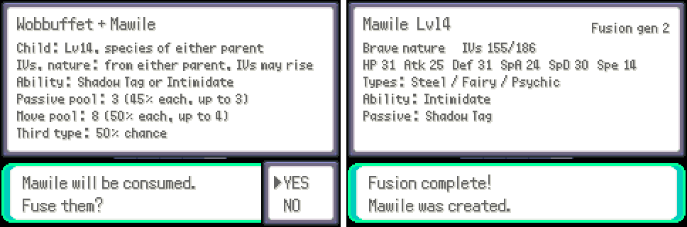
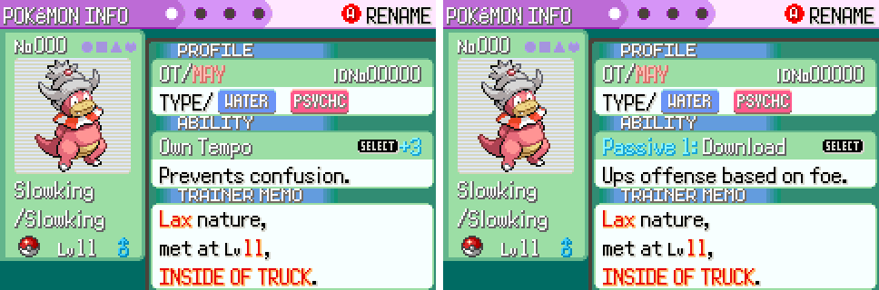
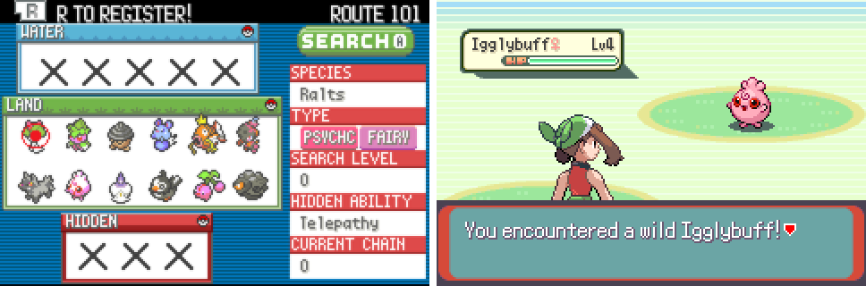
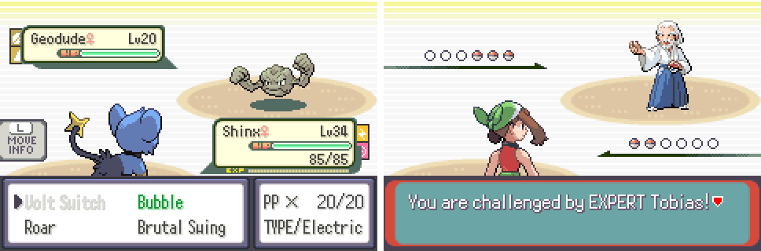
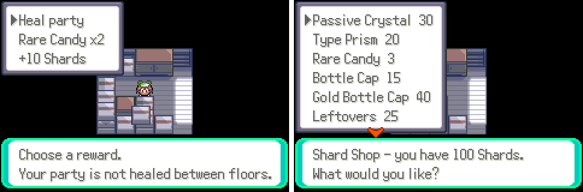

# Pokémon Emerald Fusion

A Pokémon Emerald ROM hack that brings the "fusion" (炼妖) system of *Fantasy Westward Journey* to Pokémon. You can fuse any two Pokémon into a new one, and it inherits moves, IVs, abilities, passive abilities and types. It is built on [RHH's `pokeemerald-expansion`](https://github.com/rh-hideout/pokeemerald-expansion) and keeps the full Emerald story, with Pokémon from all nine generations.

> [!IMPORTANT]
> This is an unofficial, non-commercial fan project. It is not affiliated with Nintendo, Game Freak, Creatures or The Pokémon Company. This repository contains source code only and does not distribute ROM files.



## Features

### Fusion
- Use the **Fusion Terminal** to fuse two Pokémon from your party or any PC box.
  - Before you confirm, a preview card shows how each part is inherited and how likely each outcome is: species, nature, IVs, ability, passives, moves and third type.
  - The child takes the first parent's slot. The second parent is consumed.
- **One main ability plus up to 3 passive abilities.** Passives work in battle just like the main ability. About 150 common abilities are supported as passives, and the opposing AI takes them into account.
- **Up to 3 types.** The third type counts for type matchups, STAB and move effects.
- **Appraise** shows a Pokémon's IVs, nature, abilities, passives, types and fusion generation.



### Catching and exploring
- **All-generation wild encounters.** Every area's wild Pokémon are replaced by Gen 1–9 Pokémon of similar strength and the same evolution stage.
  - Each area stays the same for the whole save. A new game rolls a new world.
  - You can switch back to the original encounters in Settings.
- Wild Pokémon sometimes carry a passive or a third type, and they are appraised as soon as you catch them.
- There are three capture modes:
  - Classic: vanilla catch rates.
  - Convenient: 2× easier.
  - Material: always caught, except legendaries.
- From the start of the game you have DexNav, a portable PC (Box Link), running shoes and a party-wide Exp. Share.



### Battle
- When you choose a move, its name is coloured by how effective it is against the target. Green means super effective, red means not very effective and grey means no effect.
- Type icons are always shown, so third types are easy to spot.



### Post-game
- **Fusion Tower** unlocks after the Hall of Fame. It is an endless, roguelike challenge:
  - Opponents grow stronger with every floor.
  - Your party is not healed between floors.
  - After each win you pick one of three rewards. One loss ends the run.
- **Shard Shop**: spend the Shards you earn in the tower.
  - Passive Crystals give a random passive.
  - Type Prisms give a random third type.
  - Battle items are also sold.
- **Reincarnation (New Game+)**: start a freshly rolled world.
  - Your party comes along at Lv. 5 and keeps its IVs, moves and genes.
  - Trainers get stronger every cycle.



### Quality of life
- Fast text by default.
- Exact IV/EV values.
- Move relearners.
- A prompt to use another Repel when one wears off.
- A short introduction the first time you open the Fusion Terminal.

See the [UX review](docs/fusion/UX_REVIEW.md) for details.

## How to play

No ROMs are provided. Build the game yourself as described below, then play the resulting `.gba` file in any GBA emulator. [mGBA](https://mgba.io/) is recommended.

The Fusion Terminal is in the Key Items pocket of your Bag from the start of a new game.

## Building

See [`INSTALL.md`](INSTALL.md) to set up the toolchain. The steps are the same as for upstream `pokeemerald-expansion`.

```sh
make -j$(nproc)            # development build: pokeemerald.gba, with the debug menu (R + START)
make release -j$(nproc)    # release build: pokeemerald-release.gba, no debug features, recommended for playing
make check -j$(nproc)      # run the test suite
```

> [!NOTE]
> Don't use GitHub's "Download ZIP" option. It doesn't include the commit history, which you need to merge upstream updates. Use `git clone` instead.

## Documentation

- [`docs/fusion/ROADMAP.md`](docs/fusion/ROADMAP.md): design and implementation notes for each phase, the save layout and known issues.
- [`docs/fusion/UX_REVIEW.md`](docs/fusion/UX_REVIEW.md): the UX review and the improvements that came out of it.
- [`docs/fusion/research/`](docs/fusion/research/): research notes on multiple abilities, triple types and the save format.
- [`dev_scripts/fusion_harness/`](dev_scripts/fusion_harness/): a headless mGBA harness that runs scripted inputs, takes screenshots and saves and loads states.
- Code is in `src/fusion/`, `include/fusion/` and `data/scripts/fusion.inc`. Tests are in `test/fusion/`.
- Tunable values are in [`include/fusion/fusion_config.h`](include/fusion/fusion_config.h): inheritance odds, wild gene odds, tower difficulty and more.

The design docs under `docs/fusion/` are written in Chinese.

## Reporting bugs

Please report bugs in this hack to [this repository's issues](https://github.com/Andyism1014/Poke-fusion/issues), not upstream. Only engine bugs that also happen in vanilla `pokeemerald-expansion` should go to RHH, following their [`CONTRIBUTING.md`](CONTRIBUTING.md).

## Credits

```
Based off RHH's pokeemerald-expansion 1.17.2 https://github.com/rh-hideout/pokeemerald-expansion/
```

- **[RHH (Rom Hacking Hideout)](https://github.com/rh-hideout/pokeemerald-expansion)** made `pokeemerald-expansion`, the engine behind this hack and most of its features.
  - The contributors are listed in [`CREDITS.md`](CREDITS.md). Please consider crediting them too.
  - The engine's features are listed in [`FEATURES.md`](FEATURES.md), and its documentation is at [rh-hideout.github.io/pokeemerald-expansion](https://rh-hideout.github.io/pokeemerald-expansion/).
- **[pret](https://github.com/pret/pokeemerald)** made the `pokeemerald` decompilation that `pokeemerald-expansion` is built on.
- Pokémon and all related names and images are © Nintendo, Game Freak, Creatures and The Pokémon Company.
