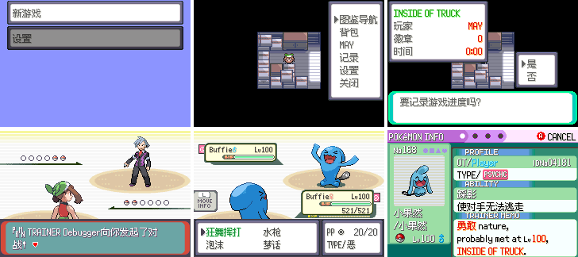

# 简体中文版

同一份源码可以编译出英文版和简体中文版两个 ROM。中文版的文本不改源文件，而是放在 `text_zh/` 的翻译文件里，编译中文版时由 `tools/preproc` 替换进去；没翻译的文本保持英文。

```sh
make -j$(nproc)                    # 英文版 pokeemerald.gba（和以前完全一样）
make chinese -j$(nproc)            # 中文版 pokeemerald-zh.gba
make chinese release -j$(nproc)    # 中文发布版 pokeemerald-zh-release.gba
make check CHINESE=1 TESTS="..."   # 用中文文本跑测试（比如检查名字宽度的 "fit" 测试）
make tidychinese                   # 只删除中文版的编译产物
```



中文版的目标文件在 `build/emerald-zh*/`，生成的字库、码表和词典在 `build/zh/`，和英文版互不影响。英文版编译时不读取 `text_zh/`，所有中文相关代码都在 `#if FUSION_CHINESE` 里。

## 翻译流程

```sh
python3 tools/zh/zh.py extract              # 把源码里新增/改动的英文文本加进 text_zh/**.po
python3 tools/zh/zh.py stats [--files]      # 翻译进度（按区域 / 按文件）
python3 tools/zh/zh.py missing maps/Littleroot --limit 50   # 列出未翻译条目
python3 tools/zh/zh.py lint [PREFIX]        # 检查行宽、\n \l \p、占位符、结尾的 $
python3 tools/zh/zh.py fit                  # 检查名字和说明在界面里放不放得下
python3 tools/zh/zh.py apply 译文.tsv       # 批量填入：每行 英文或标签<TAB>中文
make chinese -j$(nproc)                     # 编译，看效果
```

1. 改了英文源码（加了新对话、新字符串）以后先跑 `extract`。它只会添加条目、更新引用位置，不会动已有的译文。英文原文变了的剧本条目会被标记为 `#, fuzzy`（旧译文照样使用，`stats` 会统计，`missing --fuzzy` 能列出来）；源码里已经没有的条目变成 `#~` 注释保留。
2. 直接编辑 `.po` 文件，把 `msgstr ""` 填上。也可以写一个 TSV 用 `apply` 批量填入（不会覆盖已有译文，除非加 `--force`）。
3. 跑 `lint`，再 `make chinese` 编译。改了哪个翻译，只会重新编译用到它的目标文件：剧本文本只重编 `data/event_scripts.o`（几秒），C 字符串只重编包含这个字符串的 `.c`。
4. 出现字库里没有的字时，编译会报错并指出是哪个 PO 文件。Fusion Pixel 收录了 GB2312 全部汉字和常用的 GBK 汉字，基本不会遇到；真遇到了可以在 `graphics/fonts/zh/cjk_12px_extra.hex` 里手绘（见下文）。

### 文件布局

| 文件 | 内容 |
| --- | --- |
| `text_zh/scripts/maps/<地图>.po` | `data/maps/<地图>/scripts.inc` 的对话 |
| `text_zh/scripts/text/*.po`、`text_zh/scripts/scripts/*.po`、`text_zh/scripts/event_scripts.po` | `data/text/*.inc`、`data/scripts/*.inc`、`data/event_scripts.s` 的文本 |
| `text_zh/src/<路径>.po` | 该 C 源文件 / 头文件里的 `_("...")`、`COMPOUND_STRING("...")`、`ITEM_NAME("...")` |

PO 文件用的是标准 PO 语法，但字符串**原样照抄游戏源码**：`\n \l \p`、`{PLAYER}`、`{STR_VAR_1}`、`\"` 都和源码里的写法一样（所以不要用 `msgfmt` 处理这些文件）。

**剧本文本**（`text_zh/scripts/`）一个标签一个条目，整段翻译，可以自由重新断行：

```po
#: data/maps/LittlerootTown/scripts.inc:919
msgctxt "LittlerootTown_Text_WaitPlayer"
msgid "MOM: Wait, {PLAYER}!$"
msgstr "妈妈：等一下，{PLAYER}！$"
```

`msgctxt` 是标签名，`msgid` 是英文原文（只用来对照和检测改动），编译时按标签替换整段 `.string`。结尾的 `$` 要保留。

**C 字符串**（`text_zh/src/`）按英文原文匹配，同一个英文字符串在所有文件里都用同一个译文。某个文件里需要不同译文时，加一个以该文件路径为 `msgctxt` 的条目，它的优先级更高：

```po
msgctxt "src/data/types_info.h"
msgid "Psychic"
msgstr "超能力"
```

官方译名都是这样按文件区分的（招式“精神强念”和属性“超能力”英文都是 Psychic）。一个英文字符串第一次出现在哪个文件，它的条目就放在那个文件对应的 PO 里，`#:` 列出了所有用到它的位置。

### 行宽和断行

一个汉字（含全角标点）宽 12px；在 FONT_NARROW 系列里宽 11px，在 FONT_NARROWER 系列里宽 10px（这两套是把字形横向压缩了一两列，名字、说明这类空间紧的地方会自动换用）。英文字母大多 6px，`{PLAYER}` 最长 7 个英文字母约 42px。

| 位置 | 宽度 | 每行最多 |
| --- | --- | --- |
| 野外对话框（msgbox） | 216px | 18 个汉字；页面最后一行建议 ≤17 个（右下角有翻页箭头） |
| 战斗对话框（含训练家战败台词） | 208px | 17 个汉字；战斗消息没有手动断行时会自动断行（见下） |
| 特性说明（能力页，FONT_NARROWER） | 146px | 14 个汉字 |
| 招式名（战斗招式栏 / 华丽大赛，FONT_NARROWER） | 64px / 59px | 6 / 5 个汉字 |
| 宝可梦名（队伍、图鉴、华丽大赛，FONT_NARROWER） | 50px | 5 个汉字 |
| 道具名（盒子里携带物 / 能力页 / 背包） | 66px / 72px / 88px | 6 / 7 / 8 个汉字 |
| 宝可梦名 / 昵称 | 12 字节 | 6 个汉字（编译期检查） |
| 特性名 | 16 字节 | 8 个汉字；特性弹窗 76px，最多 6 个汉字 |
| 道具名 | 19 字节 | 9 个汉字（编译期检查） |
| 属性名 | 8 字节 | 4 个汉字 |
| 玩家名 / 训练家名 | 7 / 10 字节 | 3 / 5 个汉字 |

断行规则和英文版一样：一页两行，`\n` 换到第二行，第三行起用 `\l`（滚动一行），`\p` 翻页。中文不需要在行尾留空格。`lint` 会估算每行宽度并报告超过 216px 的行（占位符按估计宽度计算）。

战斗消息（`src/battle_message.c` 等）英文原文本来就不带换行，游戏会按实际宽度自动断行；中文版的自动断行可以在任意两个汉字之间断开，不会把“，。！？”等放到行首。这类字符串翻译时**不要**加 `\n`。物品说明在显示时也会去掉换行再重新排版。

标点用全角：，。！？：；“”‘’……——（）、《》。半角的 `! ? , .` 也能用，但只有 6px 宽，和汉字混排不好看；数字、`HP`、`PP`、`Lv.` 保持半角。

### 宽度检查

`python3 tools/zh/zh.py fit` 按 `test/text.c` 里 "... fit on ..." 测试的宽度检查宝可梦名、招式名、道具名、特性名和特性说明的译文，列出放不下的。也可以直接用中文文本跑这些测试（其他战斗测试会因为对照英文消息而失败，不用管）：

```sh
make check CHINESE=1 TESTS="Ability descriptions fit" -j$(nproc)
```

目前放不下的都是官方译名本身太长：7、8 个字的 Z 招式和超极巨招式（华丽大赛 / 战斗招式栏）、6 个字的招式在华丽大赛界面（59px）、5 个字的宝可梦名在华丽大赛排名（49px，差 1px）、7、8 个字的道具名（主要是“××进化石”）在盒子里的携带物窗口（66px）。这些界面要么换更窄的写法，要么调整界面，需要另行决定。

## 官方译名

宝可梦名、分类、招式名、特性名、道具名、属性名、性格名来自 [PokeAPI](https://github.com/PokeAPI/pokeapi/tree/master/data/v2/csv)（`local_language_id` 12 = zh-Hans），由 `tools/zh/import_pokeapi.py` 导入：

```sh
python3 tools/zh/import_pokeapi.py 下载的CSV目录 --report report.txt
```

导入的条目带 `#. PokeAPI` 注释，重新导入只会更新带这个注释的条目；手动改过的译名删掉这行注释就不会被覆盖。PokeAPI 没有的名字（极巨招式的官方译名、第三世代的邮件、本作的道具等）写在脚本里的 `EXTRA_NAMES`，其中非官方的译名带 `#. not an official name`。特性说明不是官方文本，是按游戏里的英文说明重写的短句（能力页一行放得下）。

## 实现

### 编码

汉字是双字节：**前导字节**取 `0x3B-0x4F` 或 `0x87-0x9F`（所有拉丁字体里这些位置都是空白，英文文本从不使用），**后续字节**取 `0x01-0xF6`（避开 `EOS`、控制码 `0xF7-0xFF` 和会被改写成 NBSP 的空格 `0x00`）。字形编号 = 前导字节序号 × 246 + 后续字节 − 1，最多 11316 个字形。定义在 `include/text_cjk.h` 和 `tools/zh/zhlib.py`，两边要保持一致。

码表的前 6600 多个是 GB2312 的符号和全部汉字（按 GB2312 顺序，固定不变），后面追加译文里用到的 GB2312 以外的字（记录在 `build/zh/extra_chars.txt`，只追加不重排）。全角标点和 `“”‘’…` 只在**译文**里使用全角字形，英文原文里的同一个字符仍然是英文字形，所以没翻译的英文文本和英文版完全一样。

### 字库

`graphics/fonts/zh/cjk_12px.hex` 是从 [Fusion Pixel Font](https://github.com/TakWolf/fusion-pixel-font) 12px proportional（zh_hans，v2025.03.14，SIL OFL 1.1，许可证见同目录的 `OFL.txt` 和 `LICENSE/`）转换出来的点阵，收录 GB2312 符号区和所有 CJK 汉字，用 `tools/zh/bdf_to_hex.py` 生成。每行格式是 `码位:宽度:12 行 × 16 位十六进制`，第 0 行在基线上方 10px。

字库缺的字（目前有“鳅、獒、戽”，都在宝可梦名里）在 `cjk_12px_extra.hex` 里手绘，格式相同。

编译时 `zh.py build` 把码表里的字转换成和拉丁字体相同的 2bpp 16×16 格式（每字 64 字节），笔画在第 1-12 行，带第三世代风格的右下阴影。一共三套：普通（12px）、窄（压缩一列，11px）、更窄（压缩两列，10px），压缩时合并相邻两列里差别最小的那一对。三套共约 1.3MB，中文 ROM 目前用了 28.1MB / 32MB。`src/text_cjk.c` 负责解码；`src/text.c` 的文字打印机和 `GetStringWidth`、`src/line_break.c` 的自动断行、`src/string_util.c` 的 `IsStringJapanese` / `StringCopyUppercase` 能识别双字节字符。小字体（FONT_SMALL）里字形上移一行。

### 编译流程

- `tools/zh/zh.py build --out build/zh` 读取所有 PO 文件，生成 `translations.tsv`（给 preproc 的词典）、`charmap.txt`（译文用的全角码表）、字库文件，以及 `deps/**.hash`：每个目标文件一个，内容是它用到的译文的哈希，只有变化时才改写，所以改一条翻译只重编相关的目标文件。规则在 `chinese_rules.mk`。
- `tools/preproc` 新增两个参数：`-t 词典` 替换 C 字符串（按“文件 + 英文原文”或“英文原文”查找）和剧本文本块（标签后面连续的 `.string` 行，直到以 `$` 结尾的那一行），`-z 码表` 是译文优先使用的码表。英文版不传这两个参数，输出不变。
- 文本块的识别规则和 `zh.py extract` 一样：标签后面（可以隔空行）的 `.string` 行；带填充长度的 `.string "...", N` 不翻译；`.if IS_FRLG` 里的火红/叶绿内容不提取。

## 实机检查

`dev_scripts/fusion_harness/` 里有三个中文版检查脚本（截图在 OUT_DIR）：

```sh
cd dev_scripts/fusion_harness
./run.sh ../../pokeemerald-zh.gba scripts/zh_main_menu.txt out/zh          # 标题、主菜单
./run.sh ../../pokeemerald-zh.gba scripts/boot_to_overworld.txt out/boot   # START 菜单，生成 overworld.ss0
./run.sh --state out/boot/overworld.ss0 ../../pokeemerald-zh.gba scripts/zh_save_prompt.txt out/zh       # 对话框 + 是/否
./run.sh --state out/boot/overworld.ss0 ../../pokeemerald-zh.gba scripts/zh_battle_summary.txt out/zh   # 战斗、队伍、能力页
```

## 已知限制

- 命名界面只能输入英文，玩家名和昵称仍是英文字母（默认名可以翻译）。
- 图鉴的按字母排序 / 搜索、简易会话（easy chat）的单词排序仍按英文规则。
- 界面布局是按英文设计的，部分窗口里的中文可能需要调整坐标或换用窄字体，需要实机检查。
- 双字节字符被截断时（比如超长昵称）会少显示半个字，不会乱码。
- 联机、录像等和日版互通的功能没有考虑中文。
- 英文版 ROM 的二进制和改动前只差 `text.c`、`string_util.c` 里断言信息的行号（`errorf` 用了 `__LINE__`），功能完全相同。
